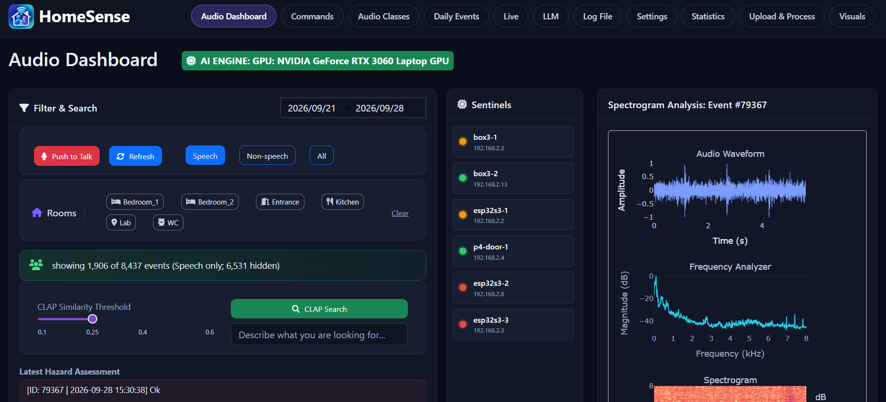

# HomeSense

The server side of a home audio sentinel system. ESP32-S3 and ESP32-P4 devices
listen in each room and send short clips when something happens; this server
classifies what was heard, transcribes and attributes the speech, and builds a
daily picture of household activity and interaction.

Recording is event-triggered rather than continuous, and audio is processed on
the premises. Only derived representations are kept.



The audio dashboard: filter and semantic search over recorded events, sentinel
health, and per-event waveform, spectrum and spectrogram.

## What the server does with a clip

Sound classification against the AudioSet ontology, voice activity detection,
speech recognition, diarisation and speaker identification, a dimensional
emotion estimate, and a CLAP embedding that makes the archive searchable by
description rather than by label.

Above the per-clip record, a layered pipeline turns events into observations,
semantic events, activity episodes, person-level episodes and a daily summary,
with one interpretive stage that reads what passed between people in an
exchange.

## Technology stack

The server runs on Windows with an NVIDIA GPU, in a conda environment with
Python 3.10. The Python packages, at the versions it runs with, are in
[`requirements.txt`](requirements.txt):

```bash
conda create -n dash_env python=3.10
conda activate dash_env
pip install -r requirements.txt
```

What they are for:

| Area | Libraries |
|---|---|
| Deep learning | PyTorch and torchaudio (CUDA 13.0 build), Hugging Face Transformers and Accelerate |
| Sound classification and search | Audio Spectrogram Transformer (AudioSet) and CLAP, both through Transformers |
| Speech | faster-whisper with CTranslate2 (recognition), pyannote.audio (diarisation), SpeechBrain ECAPA (speaker identification), WebRTC VAD, ONNX Runtime |
| Audio | librosa, soundfile, pydub, mutagen, soxr, PyAudio, sounddevice, PyOgg (Opus), PyAV |
| Data | NumPy, SciPy, pandas, scikit-learn, Matplotlib |
| Dashboard | Dash with Dash Bootstrap Components and Dash AG Grid, Plotly, Flask, diskcache |
| Messaging and mobile API | paho-mqtt, FastAPI with Uvicorn, Pydantic, PyJWT, cryptography |
| Language models | OpenAI client for hosted models; local models through Ollama |

Programs installed separately, outside pip:

| Program | Why |
|---|---|
| [NVIDIA driver and CUDA 13.0](https://developer.nvidia.com/cuda-downloads) | GPU inference. `gpu_asr/` carries the `cublas64_12.dll` that faster-whisper needs |
| [ffmpeg](https://ffmpeg.org/download.html), on the `PATH` | Reading and converting audio, encoding video clips |
| [Mosquitto](https://mosquitto.org/download/) | The MQTT broker the sentinels talk to, on 1883 and 8883 (TLS). It must be running before the app starts |
| [Ollama](https://ollama.com/download) (optional) | Local language models for the LLM report and GraphRag |
| [ESP-IDF](https://docs.espressif.com/projects/esp-idf/) | Only to build the sentinel firmware in `sentinels/` |

## Installation

These steps are for Windows 10 or 11 with an NVIDIA GPU (developed on an
RTX 3060 Laptop GPU with 6 GB) and Anaconda installed in the default place.

1. **Get the code.**

   ```bash
   git clone https://github.com/potamitis123/homesense.git
   cd homesense
   ```

2. **Create the Python environment** (see Technology stack above):

   ```bash
   conda create -n dash_env python=3.10
   conda activate dash_env
   pip install -r requirements.txt
   ```

3. **Install the programs outside pip:** the NVIDIA driver and CUDA 13.0,
   ffmpeg (on the `PATH`), Mosquitto (in `C:\Program Files\mosquitto`), and
   optionally Ollama for local language models.

4. **Write your settings.** Copy `common_files/parameters.example.json` to
   `common_files/parameters.json` and fill in:

   | Setting | Needed for |
   |---|---|
   | `mqtt.password` | The broker the sentinels publish to |
   | `diarization.hf_token` | pyannote speaker diarisation. A Hugging Face token, after accepting the terms of `pyannote/speaker-diarization-3.1` |
   | `openai.api_key` | Optional: hosted models for the LLM report and GraphRag |
   | `https` | Certificate paths for the dashboard; set `"https": false` to run it over plain HTTP |

   `parameters.json` is never committed. The secrets can also be given as
   environment variables instead: `MQTT_USERNAME`, `MQTT_PASSWORD`, `HF_TOKEN`
   and `OPENAI_API_KEY`.

5. **Provide TLS certificates.** The broker accepts sentinels on port 8883 with
   mutual TLS, so it needs a CA certificate and a server certificate and key,
   and each sentinel needs a client certificate signed by the same CA. Put yours
   in `certs/certs/` and change the paths in `mosquitto.conf` (they are absolute
   and point to the author's machine) and in the `https` part of
   `parameters.json`. Certificates are not in this repository.

6. **Enrol the residents' voices.** Make one folder per person under
   `speakers/` (for example `speakers/Anna/`) with a few recordings of that
   person speaking, then run:

   ```bash
   python speakers/build_speaker_model.py
   ```

   It writes `speakers/speakers_model.pth` and prints a table of how well the
   voices can be told apart. Without it, speech is transcribed but not
   attributed.

7. **Build and flash the sentinels.** Each board has its own ESP-IDF project in
   `sentinels/`. Its README says where the Wi-Fi and broker settings and the
   client certificate go.

## Running

**Everything at once:**

```bash
boot_sentinel.bat
```

It starts Mosquitto, runs pre-flight checks, then opens one window each for the
recording pipeline, the dashboard and the mobile API, restarting any of them
that stops. It expects Anaconda in `%USERPROFILE%\anaconda3` and Mosquitto in
`C:\Program Files\mosquitto`; change the lines at the top of the file if yours
are elsewhere. It opens the dashboard at the address in `DASHBOARD_URL`.

**Or by hand,** each in its own window, broker first:

```bash
mosquitto -c mosquitto.conf -v
conda activate dash_env
python ast_src/main.py          # recording pipeline: classify, transcribe, store
python ast_dash/ast_app.py      # dashboard on port 8050
python mobile_api/main.py       # API for the phone app on port 8001
```

Then open `https://<server>:8050`, or `http://127.0.0.1:8050` with
`"https": false`.

**GraphRag,** for questions over days, reads each finished day once and then
answers from what it stored:

```bash
python -m graphrag.ingest --day 2026-10-26 --semantic-model gpt-4o-mini
python -m graphrag.ask "Was there a quarrel yesterday? When did it start and finish?"
```

The LLM tab of the dashboard can also prepare a day's list and ask the
residents to confirm it. `RUNBOOK.md` lists every other script and tool, and
`graphrag/README.md` explains GraphRag in detail.

## Status

In daily use in one household.
